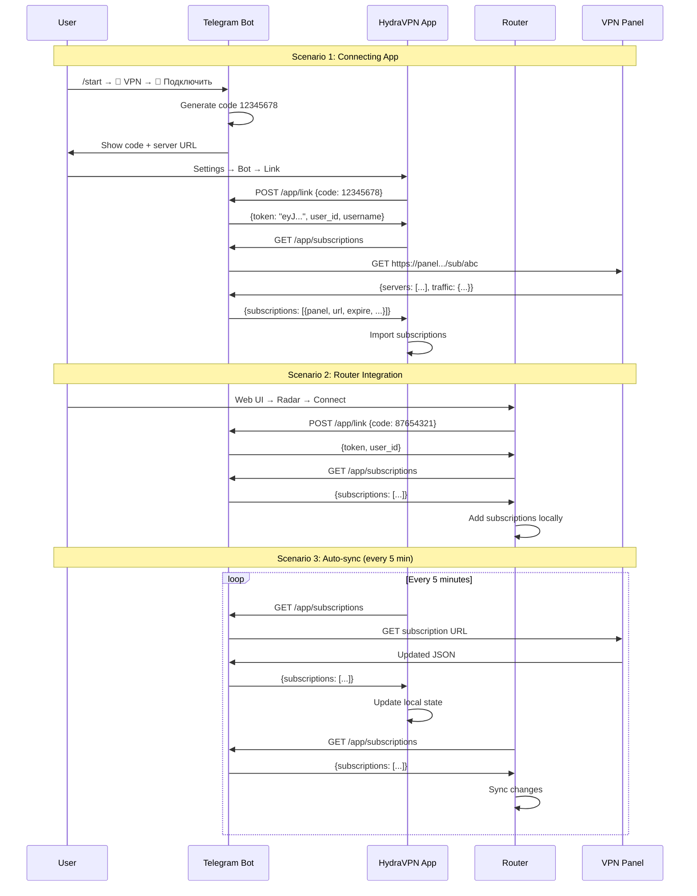

# API Integration Map: HydraVPN Ecosystem

**Дата:** 20.11.2026  
**Статус:** полная картина взаимодействия трёх проектов

---

## Обзор экосистемы

Экосистема HydraVPN состоит из трёх взаимосвязанных проектов:

1. **HydraVPN** (Android/Desktop/iOS) — мобильные и десктопные клиенты
2. **Radar** — Telegram-бот с REST API для управления подписками
3. **HydraVPN for Routers** — демон на Go для роутеров (MikroTik, OpenWrt, Linux)

Все три проекта интегрируются через **REST API бота Radar** для получения списка VPN-подписок.

---

## Архитектура взаимодействия

```
┌─────────────────────────────────────────────────────────────────────┐
│                          Telegram Bot Radar                          │
│                      (REST API /api/v1/app/*)                        │
│                                                                       │
│  - Управление пользователями через Telegram                          │
│  - Выдача одноразовых кодов для подключения приложений               │
│  - REST API для чтения подписок (HydraVPN Android/Desktop, Routers) │
│  - Хранение токенов сессий устройств                                 │
└───────────────────────────────┬─────────────────────────────────────┘
                                │
                ┌───────────────┼───────────────┐
                │               │               │
                ▼               ▼               ▼
┌───────────────────────┐ ┌──────────────────────┐ ┌───────────────────────┐
│   HydraVPN Android    │ │  HydraVPN Desktop    │ │ HydraVPN for Routers  │
│   (Kotlin Multiplatform)│ │  (Windows/Linux/macOS)│ │    (Go daemon)        │
│                       │ │                      │ │                       │
│  BotClient            │ │  BotClient           │ │  /api/v1/radar/*      │
│  - link(code)         │ │  - link(code)        │ │  - /link (POST)       │
│  - me()               │ │  - me()              │ │  - /sync (POST)       │
│  - subscriptions()    │ │  - subscriptions()   │ │  - /disconnect (DELETE)│
│  - disconnect()       │ │  - disconnect()      │ │                       │
└───────────────────────┘ └──────────────────────┘ └───────────────────────┘
                │                     │                       │
                └─────────────────────┼───────────────────────┘
                                      │
                                      ▼
              ┌─────────────────────────────────────────┐
              │     VPN Panels (3x-ui, s-ui, etc.)     │
              │  - Импорт подписок JSON через URL       │
              │  - Обновление каждые 5-10 минут         │
              └─────────────────────────────────────────┘
```

---

## Radar Bot REST API

**Базовый URL:** `https://<server-url>/api/v1/app/`  
**Включение:** флаг `app_api` в веб-панели бота (требует `web_panel=true`)  
**Документация:** [temp-radar/docs/API_APPS.md](temp-radar/docs/API_APPS.md)

### Эндпоинты

#### 1. Ping (проверка доступности)
```
GET /api/v1/app/ping
```
**Response:**
```json
{
  "ok": true,
  "message": "HydraVPN API"
}
```

#### 2. Link (вход по коду)
```
POST /api/v1/app/link
Content-Type: application/json

{
  "code": "12345678",
  "device_name": "HydraVPN Android 0.8.3",
  "device_id": "uuid"
}
```
**Response:**
```json
{
  "ok": true,
  "token": "eyJ...",
  "user_id": "123456789",
  "username": "john_doe"
}
```

#### 3. Me (профиль пользователя)
```
GET /api/v1/app/me
Authorization: Bearer <token>
```
**Response:**
```json
{
  "ok": true,
  "user_id": "123456789",
  "username": "john_doe",
  "vpn_state": "active",
  "panels": 3
}
```

#### 4. Subscriptions (список подписок)
```
GET /api/v1/app/subscriptions
Authorization: Bearer <token>
```
**Response:**
```json
{
  "ok": true,
  "subscriptions": [
    {
      "panel": "main",
      "title": "Main Server",
      "link_kind": "subscription",
      "state": "ok",
      "enabled": true,
      "url": "https://panel.example.com/sub/abc123",
      "expire": 1735689600,
      "traffic_limit": 107374182400,
      "traffic_used": 10737418240
    }
  ]
}
```

#### 5. Session (отключение устройства)
```
DELETE /api/v1/app/session
Authorization: Bearer <token>
```
**Response:**
```json
{
  "ok": true,
  "message": "Session deleted"
}
```

### Типы состояний подписки

| `state` | Описание |
|---------|----------|
| `ok` | Подписка активна, URL доступен |
| `no_link` | Подписка создана, но ссылка ещё не задана |
| `panel_error` | Панель вернула ошибку |
| `missing` | Подписка удалена из панели |

### Типы ссылок

| `link_kind` | Описание |
|-------------|----------|
| `subscription` | Стандартная ссылка подписки JSON (https://...) |
| `key` | Одиночный ключ (vless://, vmess://, ss://, etc.) |
| `config` | Файл конфигурации (sing-box JSON) |

---

## HydraVPN (Android/Desktop) Integration

**Файл:** `shared/src/commonMain/kotlin/ru/gidravpn/hydra/bot/BotAccount.kt`

### Модели данных

#### BotSubscription
```kotlin
data class BotSubscription(
    val panel: String,           // ID панели
    val title: String,           // Название подписки
    val linkKind: String,        // "subscription" | "key" | "config"
    val state: String,           // "ok" | "no_link" | "panel_error" | "missing"
    val enabled: Boolean,        // Включена ли подписка
    val url: String,             // URL подписки или ключ
    val expire: Long = 0,        // Unix timestamp окончания (0 = бессрочно)
    val trafficLimit: Long = 0,  // Лимит трафика в байтах (0 = без лимита)
    val trafficUsed: Long = 0    // Использованный трафик в байтах
) {
    val isJsonLink: Boolean get() = linkKind == "subscription"
    fun toSubscription(): Subscription = // конвертация в модель приложения
}
```

#### BotProfile
```kotlin
data class BotProfile(
    val userId: String,
    val username: String,
    val vpnState: String,  // "active" | "disabled" | "pending"
    val panels: Int
)
```

### BotClient (HTTP клиент)

```kotlin
class BotClient(val baseUrl: String, var token: String? = null) {
    
    fun ping(): Result<Boolean>
    
    fun link(code: String, deviceName: String, deviceId: String): Result<LinkResponse>
    
    fun me(): Result<BotProfile>
    
    fun subscriptions(): Result<List<BotSubscription>>
    
    fun disconnect(): Result<Unit>
}
```

### Retry логика (добавлена в 0.8.3-b2)

- **Попытки:** до 3 раз
- **Пауза:** 2.5 секунды × номер попытки (2.5с, 5с, 7.5с)
- **Коды для retry:** 500, 502, 503, 504, IOException

### BotSyncPlanner (планировщик обновлений)

- **Интервал:** каждые 5 минут
- **Задачи:**
  - Обновление списка подписок
  - Импорт новых подписок
  - Удаление отключённых
  - Проверка истечения срока/трафика

---

## HydraVPN for Routers Integration

**Репозиторий:** github.com/Chistovik92/HydraVPNforRouters (приватный)  
**Документация:** [temp-routers/docs/API.md](temp-routers/docs/API.md)

### API эндпоинты роутера

**Базовый URL:** `http://<router-ip>:<api_port>/api/v1/`  
**Авторизация:** `Authorization: Bearer <api_token>`

#### 1. Подключение к боту Radar
```
POST /api/v1/radar/link
Content-Type: application/json

{
  "base_url": "https://radar.example.com",
  "code": "12345678",
  "device_name": "Home Router",
  "device_id": "mikrotik-001"
}
```
**Response:**
```json
{
  "ok": true,
  "token": "eyJ...",
  "user_id": "123456789",
  "username": "john_doe",
  "subscriptions_added": 3
}
```

#### 2. Синхронизация подписок
```
POST /api/v1/radar/sync
Content-Type: application/json

{}
```
**Response:**
```json
{
  "ok": true,
  "subscriptions_added": 1,
  "subscriptions_updated": 2,
  "subscriptions_removed": 0,
  "total": 3
}
```

#### 3. Отключение от бота
```
DELETE /api/v1/radar/disconnect
```
**Response:**
```json
{
  "ok": true,
  "message": "Radar account disconnected"
}
```

#### 4. Статус интеграции
```
GET /api/v1/radar/status
```
**Response:**
```json
{
  "ok": true,
  "connected": true,
  "base_url": "https://radar.example.com",
  "username": "john_doe",
  "user_id": "123456789",
  "subscriptions": 3,
  "last_sync": "2026-11-20T10:30:00Z",
  "next_sync": "2026-11-20T10:35:00Z"
}
```

### Автоматическая синхронизация

- **Интервал:** каждые 5 минут
- **Триггеры:** изменение состояния подписок в боте
- **Логика:**
  1. Вызов `/api/v1/app/subscriptions` в боте Radar
  2. Сравнение с локальным списком
  3. Добавление новых подписок через `/subscriptions/add`
  4. Обновление существующих через `/subscriptions/{id}/update`
  5. Удаление отключённых через `/subscriptions/{id}/delete`

### Импорт подписок JSON

Роутер импортирует подписки типа `subscription` через:

```
POST /api/v1/subscriptions/add
Content-Type: application/json

{
  "url": "https://panel.example.com/sub/abc123",
  "name": "Main Server (Radar)",
  "auto_update": true,
  "update_interval": 300
}
```

---

## VPN Panels Integration

### Поддерживаемые панели

Из [vpn-panels-research.md](E:\Git\zero\vpn-panels-research.md):

| Панель | Stars | URL |
|--------|-------|-----|
| 3x-ui | 50,167 | github.com/MHSanaei/3x-ui |
| Hiddify-Manager | 9,623 | github.com/hiddify/Hiddify-Manager |
| s-ui | 3,366 | github.com/alireza0/s-ui |
| PasarGuard | 2,852 | github.com/PasarGuard/panel |
| x-ui | 2,644 | github.com/qist/x-ui |
| Remnawave | 1,900 | github.com/remnawave/backend |
| Nexora | 245 | github.com/Gozargah/Nexora |

### Формат подписки JSON

Стандартный формат, поддерживаемый всеми панелями:

```json
{
  "name": "Main Server",
  "servers": [
    {
      "type": "vless",
      "server": "example.com",
      "server_port": 443,
      "uuid": "abc123...",
      "flow": "xtls-rprx-vision",
      "network": "tcp",
      "security": "tls",
      "sni": "example.com"
    }
  ],
  "traffic": {
    "upload": 1073741824,
    "download": 10737418240,
    "total": 107374182400,
    "expire": 1735689600
  }
}
```

### PasarGuard Live Panel Example

Из [pasarguard-live-panel-documentation.md](E:\Git\zero\pasarguard-live-panel-documentation.md):

**Panel URL:** https://89.125.121.217:8000/dashboard/  
**Version:** v5.6.0  
**Nodes:** 15 (10+ стран)  
**Users:** 20  
**Groups:** 4 (Admin, User, User IOS, User SS)  
**Hosts/Inbounds:** 15 (VLESS+gRPC на порту 443)

**API эндпоинты:**
- `/api/v1/subscription/{token}` — JSON подписка для пользователя
- `/api/v1/subscription/{token}/info` — информация о трафике и сроке
- `/api/v1/subscription/{token}/reset` — сброс трафика

---

## Сценарии использования

### 1. Подключение HydraVPN Android к боту

1. Пользователь в боте: «🔐 VPN» → «📱 Подключить приложение»
2. Бот генерирует 8-значный код (например, `12345678`)
3. В HydraVPN Android: Settings → Bot Account → Link
4. Пользователь вводит код `12345678`
5. Приложение:
   - `POST /api/v1/app/link` с кодом
   - Получает токен сессии
   - `GET /api/v1/app/subscriptions`
   - Импортирует все подписки типа `subscription`
6. Автообновление: каждые 5 минут `GET /api/v1/app/subscriptions`

### 2. Подключение роутера к боту

1. Пользователь в боте: «🔐 VPN» → «📱 Подключить приложение»
2. Бот генерирует код `87654321`
3. В веб-интерфейсе роутера: Radar → Connect
4. Пользователь вводит URL бота (`https://radar.example.com`) и код `87654321`
5. Роутер:
   - `POST /api/v1/radar/link` на роутере
   - Роутер внутри вызывает `POST /api/v1/app/link` в боте
   - Сохраняет токен и `base_url`
   - `GET /api/v1/app/subscriptions` в боте
   - Добавляет все подписки через `/api/v1/subscriptions/add`
6. Автосинхронизация: каждые 5 минут `POST /api/v1/radar/sync`

### 3. Обновление подписки в панели

1. Администратор в панели (например, 3x-ui):
   - Добавляет нового пользователя
   - Создаёт ссылку подписки: `https://panel.example.com/sub/xyz789`
2. Администратор в боте Radar:
   - «👥 Пользователи» → Выбирает пользователя
   - «🔑 Подписки» → Добавить подписку
   - Вставляет URL `https://panel.example.com/sub/xyz789`
3. Бот проверяет URL (GET запрос), сохраняет подписку
4. Через 5 минут:
   - HydraVPN Android: `GET /api/v1/app/subscriptions` → импортирует новую подписку
   - Роутер: `POST /api/v1/radar/sync` → добавляет через `/api/v1/subscriptions/add`

### 4. Истечение срока подписки

1. Панель обновляет `expire` в JSON подписки
2. Бот Radar проверяет `expire` при GET запросе подписки
3. Приложение/роутер при следующей синхронизации:
   - Видит `state: "ok"`, но `expire < now()`
   - Отключает подписку
   - Показывает уведомление пользователю

---

## Безопасность

### Токены сессий

- **Формат:** JWT (JSON Web Token)
- **Срок действия:** бессрочно (отзыв только через DELETE /session)
- **Хранение:**
  - Android: SharedPreferences (зашифровано)
  - Desktop: Keychain (macOS), Credential Manager (Windows), Secret Service (Linux)
  - Router: файл `<runtime-dir>/radar-token` (mode 0600)

### HTTPS обязателен

- API бота **только за HTTPS** (`WEB_HTTPS=1`)
- Самоподписанные сертификаты **не принимаются** (только CA)
- Роутер может работать через HTTP (локальная сеть), но для бота требует HTTPS

### Rate limiting

- **Неправильный токен:** задержка до 5 секунд, max 4 одновременных запроса
- **Правильный токен:** никогда не блокируется

### Аудит

- Все запросы логируются в боте (IP, user_id, timestamp, endpoint)
- Веб-панель показывает подключённые устройства (device_name, device_id, last_seen)

---

## Roadmap интеграции

### Реализовано (0.8.3)

- ✅ REST API в боте Radar (`/api/v1/app/*`)
- ✅ BotClient в HydraVPN Android/Desktop
- ✅ Автообновление подписок каждые 5 минут
- ✅ Retry логика (до 3 попыток)
- ✅ Интеграция роутера с ботом (`/api/v1/radar/*`)
- ✅ Поддержка link_kind: `subscription`, `key`, `config`
- ✅ Состояния подписок: `ok`, `no_link`, `panel_error`, `missing`

### Планируется (0.8.4+)

- ⏳ WebSocket для push-уведомлений об изменениях подписок
- ⏳ Поддержка MASQUE (требует sing-box 1.14+)
- ⏳ Групповые подписки (несколько серверов в одной ссылке)
- ⏳ Автоматическое переключение на резервный сервер при недоступности
- ⏳ Статистика использования трафика по подпискам
- ⏳ Уведомления о скором истечении срока/трафика

---

## Зависимости версий

| Компонент | Версия | Требование |
|-----------|--------|------------|
| Radar Bot API | 5.9.1+ | HydraVPN 0.8.0+ |
| HydraVPN Android/Desktop | 0.8.3 | Radar 5.9.1+ |
| HydraVPN for Routers | 1.2.5+ | Radar 5.9.1+ |
| sing-box (client) | 1.14.4 | любая панель |
| sing-box (routers) | 1.13.1 | любая панель |

---

## Диаграмма последовательности (полный flow)



---

## Заключение

Экосистема HydraVPN построена вокруг **единого REST API в боте Radar**, который:

1. **Централизует управление** подписками через Telegram
2. **Унифицирует интеграцию** для Android, Desktop, iOS и роутеров
3. **Автоматизирует синхронизацию** (каждые 5 минут)
4. **Обеспечивает безопасность** (HTTPS, JWT токены, rate limiting)
5. **Поддерживает все популярные панели** (3x-ui, s-ui, Remnawave, PasarGuard, Nexora)

Все три проекта используют **один и тот же контракт API** ([API_APPS.md](temp-radar/docs/API_APPS.md)), что позволяет легко добавлять новые платформы (например, iOS, macOS) без изменений в боте или панелях.

**Конфиденциальность:** Данные о конкретных панелях (ключи, API keys, конфигурации) хранятся только в приватном репозитории E:\Git\zero и **не публикуются** в GitHub.
